<div align="center">

<pre align="center">
███╗   ███╗███████╗███████╗██╗  ██╗
████╗ ████║██╔════╝██╔════╝██║  ██║
██╔████╔██║█████╗  ███████╗███████║
██║╚██╔╝██║██╔══╝  ╚════██║██╔══██║
██║ ╚═╝ ██║███████╗███████║██║  ██║
╚═╝     ╚═╝╚══════╝╚══════╝╚═╝  ╚═╝
  O P T I M I S E R   ·   v 0 . 2 2 . 0
</pre>

### From bloated CAD to browser-ready, locally.

> Drop a STEP file in. Get a Meshopt-compressed GLB and an interactive viewer out.
> A self-hosted take on the Pixyz preprocessor. Python + your browser, no licence server.

[](https://www.python.org/)
[](https://github.com/CadQuery/OCP)
[](https://www.w3.org/TR/webgpu/)
[](https://github.com/google/draco)
[](#-license)
[](#-requirements)
[]()

</div>

---

## Screenshots

A 1,583-part, 5.4-million-triangle assembly in v0.11.

| | |
|---|---|
| 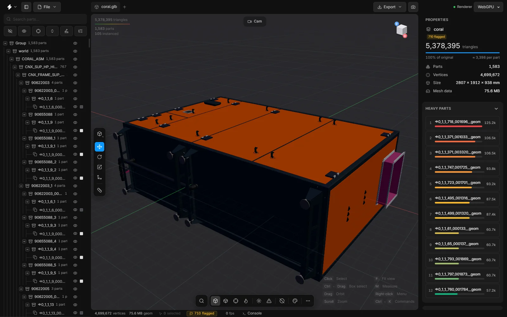<br>**The viewer** — tree, viewport, and the scene's totals | 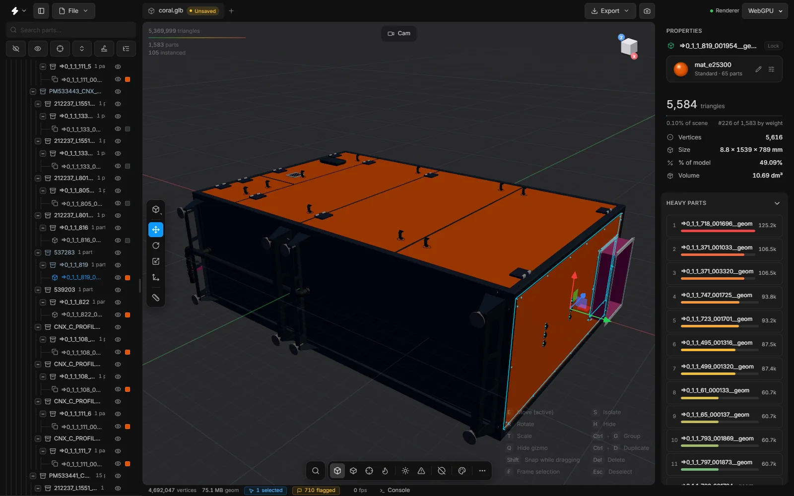<br>**Inspect** — a part's triangles, share of the scene and rank |
| 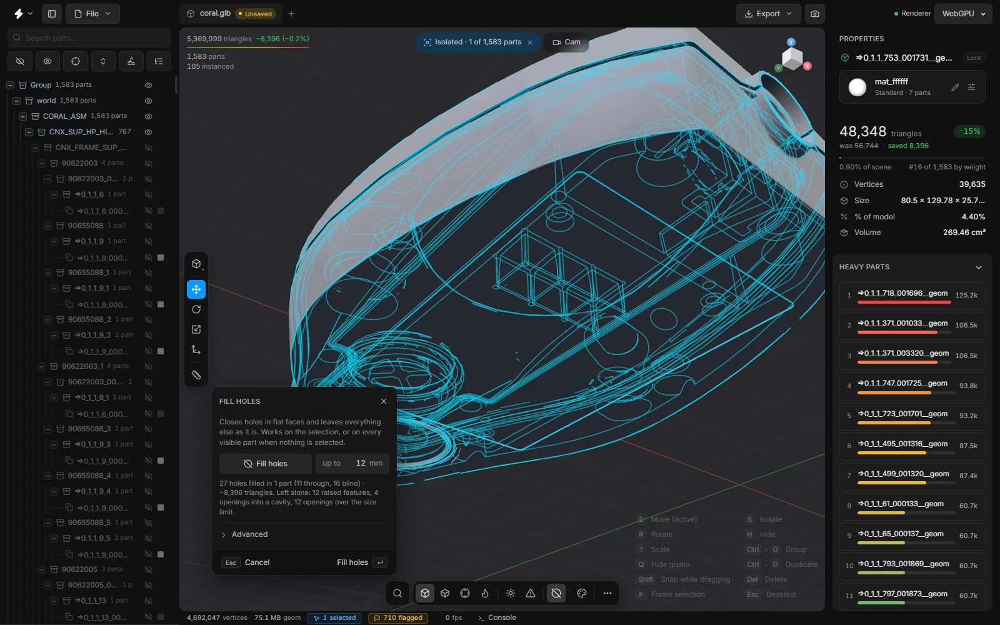<br>**Remove holes** — the command panel, and what the fill saved | 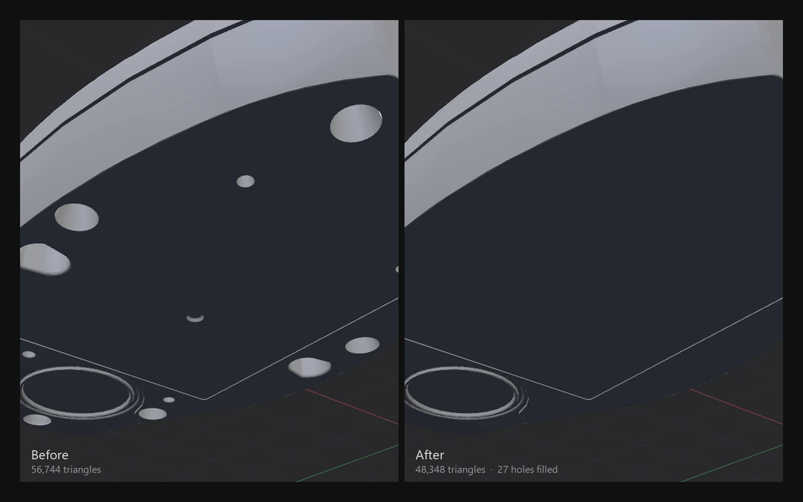<br>**Before / after** — 27 holes closed, the rest untouched |
| 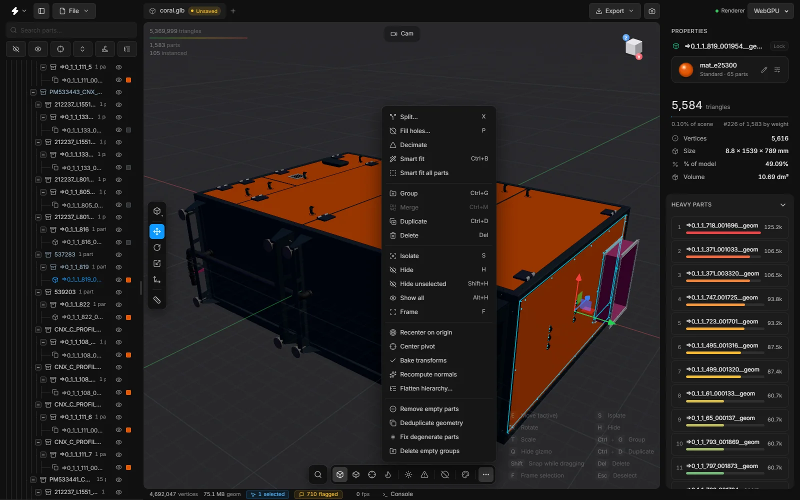<br>**All commands** — one list, with shortcuts | 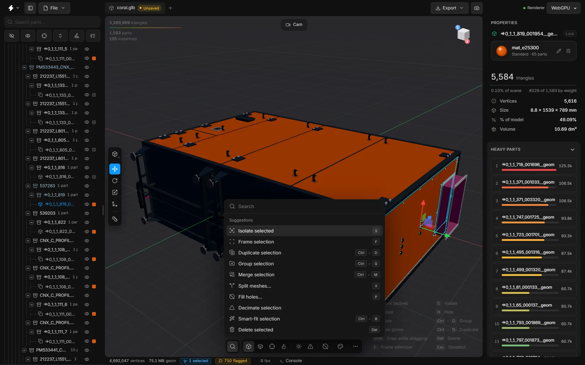<br>**Search** — suggestions follow the selection |
| 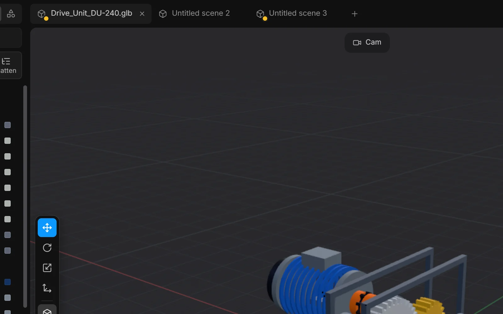<br>**Scene tabs** — every tab is its own scene | 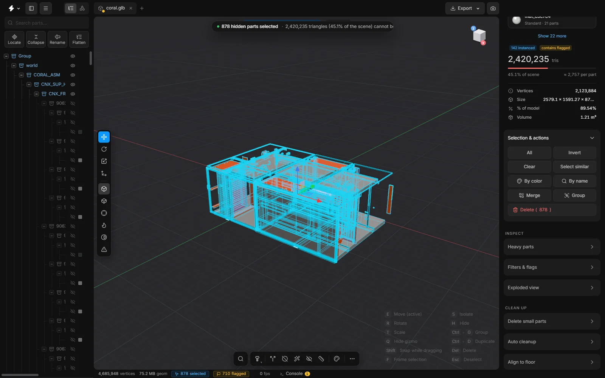<br>**Isolate** — one sub-assembly, 360 of 1,583 parts |
| 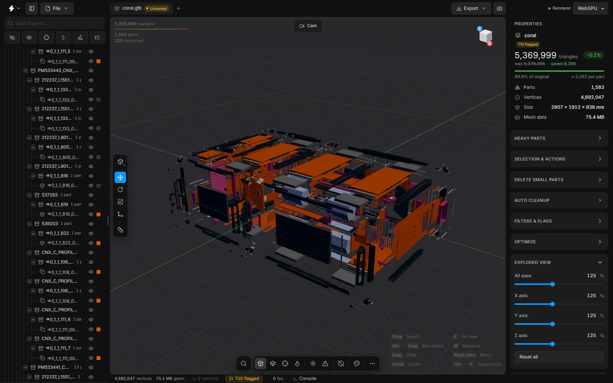<br>**Exploded view** — a slider per axis | 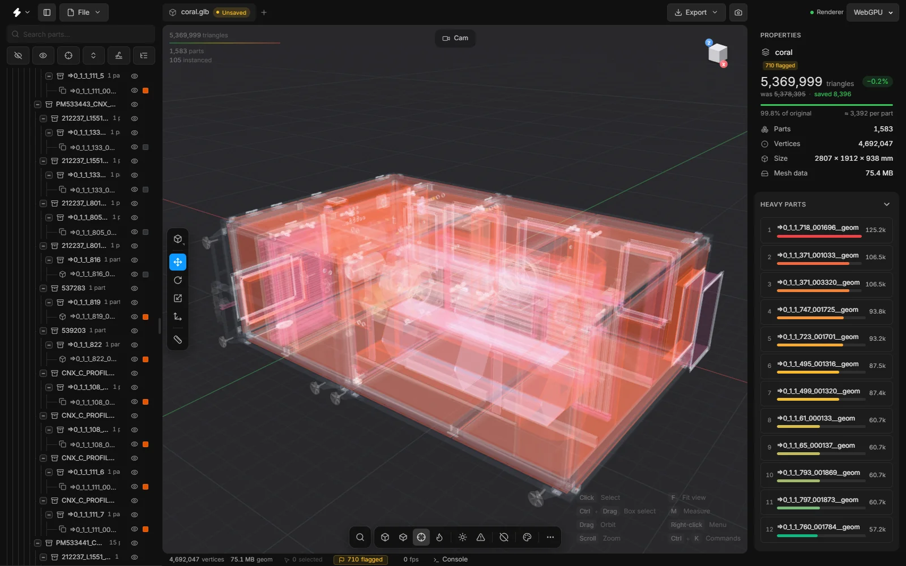<br>**X-ray** |
| 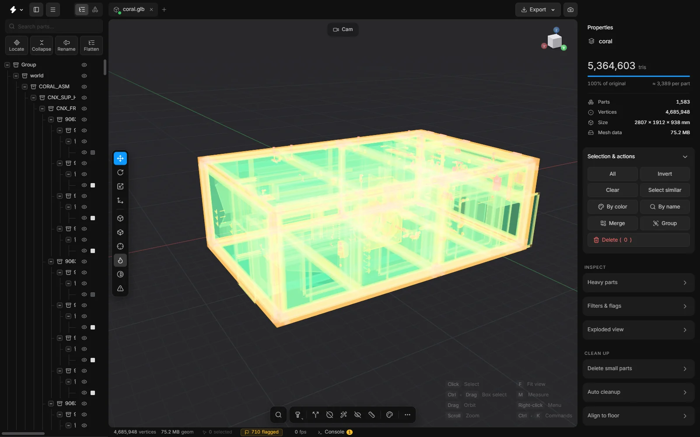<br>**Heatmap** — triangle density, beside the heavy-parts list | 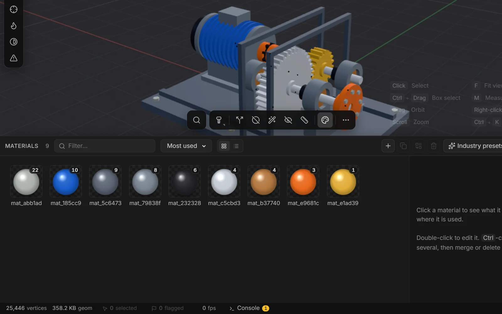<br>**Materials dock** — filter, sort, inspect |
| 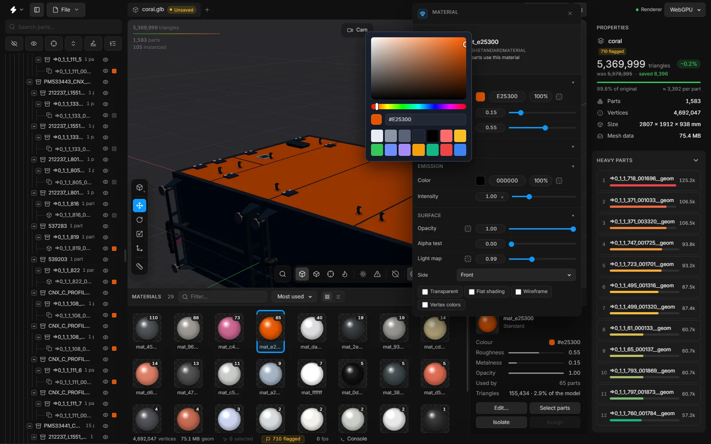<br>**Recolour** — every part that shares a material | 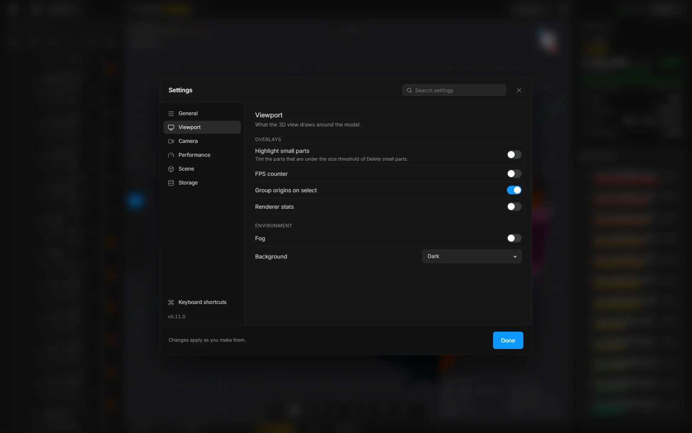<br>**Settings** — one window, with search |
| 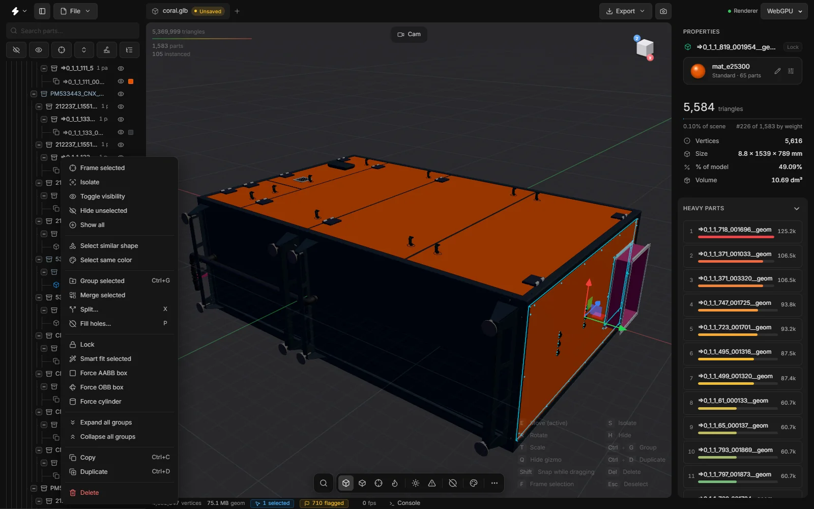<br>**Right-click menu** | 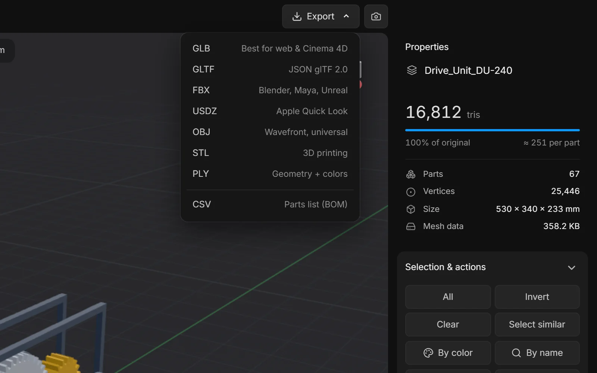<br>**Export** |

---

## Why

CAD assemblies are big. A real-world STEP file might contain 400 identical bolts,
80 duplicate brackets, and half a million degenerate triangles, and still expect
your GPU to render it.

The pipeline collapses what it can:

```
   400 bolts × 50 KB        →     1 mesh × 50 KB + 400 transforms
   80 brackets × 12 KB      →     1 mesh × 12 KB + 80  transforms
   500K bad triangles       →     adaptive retess, size-culled
   ───────────────────────────────────────────────────────────
   320 MB STEP              →     11 MB Meshopt-compressed GLB
```

---

## What's in the box

A CAD preprocessor, viewer, hierarchy editor, and exporter, in one local app.

- **Pose-normalized instancing** — PCA-based hashing detects duplicate geometry
  regardless of position or rotation. One GPU mesh, N transforms.
- **Editable assembly tree** — search, isolate, recolour, batch-rename, flatten,
  dissolve, ungroup. All undoable.
- **Two renderers** — WebGPU (default, with TSL nodes and `discardNode` clipping)
  and WebGL2. Hot-swap from the toolbar, no reload.
- **Resumable sessions** — FS Access API + IndexedDB persist file handles across
  reloads. Saved scenes for view/selection/recolour state.
- **Keyboard-first UX** — command palette (⌘K), shortcuts overlay, batch rename
  (F2), context menus, undo/redo.
- **No build step** — vanilla JS, native ES modules, CSS design tokens. Edit a
  file, refresh, done.
- **Non-destructive** — original geometry is never mutated until you export.

---

## ✨ Features

### 🛠 Pipeline (STEP → GLB)
| | |
|---|---|
| 🌳 **XCAF reader**              | Per-solid colours, names, and the full assembly tree pulled straight out of OCCT |
| 🧬 **PCA pose-normalized hash** | Same shape at any rotation/translation → **one** GPU mesh + N transforms |
| 🔷 **Adaptive tessellation**    | Absolute or relative to bbox diagonal · size culling for the tiny stuff |
| 📦 **Meshopt + Draco**          | Optional `EXT_meshopt_compression` via `gltfpack` — **~10× smaller GLBs** |
| ⚡ **One-click launch**          | `start.bat` / `start.command` bootstraps the venv and opens the app in a window of its own |
| 🔁 **Background jobs**          | Long conversions run as server jobs with live progress streamed to the UI |

### 🖥 Viewer & rendering
| | |
|---|---|
| 🌐 **Dual renderer**            | **WebGPU** (default) with hot-swap to **WebGL2** — pick from the toolbar |
| 💡 **PBR + AO + envmap**        | Studio lighting, ambient occlusion, screen-space reflections, fog |
| 🎯 **Pixel-perfect picking**    | Hover, click, marquee-select; works on instanced meshes |
| 👁 **Hide / Isolate / Solo**     | One key per mode — flatten the noise, focus on what matters |
| 🎨 **Recolor by group**         | Per-instance and per-material recolouring with reset baked-in |
| 📐 **Wireframe / Shaded / Matcap** | Three viewport modes, switchable mid-flight |
| 📊 **FPS pill**                 | Tabular-numeric FPS readout, colour-coded for stutter detection |

### 🧹 Mesh tools
| | |
|---|---|
| 🕳 **Remove holes** (`P`)         | Closes bolt holes, slots, pockets and engraved lettering in flat faces; leaves bosses, washer bores and cavity openings alone. Size limit in mm, watertight result, undoable |
| 🔩 **Fasteners**                | Finds bolts, screws, nuts and washers by their shape, whatever they are called, and selects them to isolate or delete; bushings, bearings, O-rings and pipe fittings are left alone |
| 🔻 **Decimate**                 | meshoptimizer simplifier — keeps normals, UVs and vertex colours; −25 … −90 % or a triangle target for the selection |
| 📦 **Smart fit**                | Replace parts with the best low-poly proxy: box, oriented box or cylinder |
| 🧽 **Clean-up**                 | Remove small, empty, duplicate and degenerate parts; delete empty groups; split fused meshes |
| 🎨 **Materials dock**           | Filter, sort and inspect materials; select or isolate the parts that use one; assign, merge, duplicate, PBR presets |

### 🧬 Hierarchy editing
| | |
|---|---|
| 🌳 **Live tree**                | 10 K+ nodes; only the rows on screen are built, so rebuilds stay in the tens of milliseconds |
| 🔎 **Search + filters**         | Fuzzy name search, "highlight small parts" tinting |
| ✂️ **Flatten / Dissolve**        | Collapse single-child chains, dissolve groups, ungroup scopes — all undoable |
| ✏️ **Batch rename (F2)**         | Token templates (`{name}`, `{idx}`, `{depth}`) + regex find/replace + presets |
| 🔄 **Undo / Redo**              | Tree edits, recolours, renames, flattens — all on a single timeline |
| 📌 **Right-click menu**         | Hide / isolate / recolour / rename / focus camera, all in one click |

### 📤 Export
| | |
|---|---|
| 📦 **GLB / GLTF**               | Draco + Meshopt compression toggles, optional embedded textures |
| 🎬 **FBX / USDZ / OBJ / STL**   | Common DCC + AR formats, scale presets (mm/cm/m/in) or custom |
| 🧷 **Save Scene**               | Snapshot view + selection + recolours into a sidecar `.scene.json` |

### 🧰 UX & polish
| | |
|---|---|
| 👋 **Welcome modal**            | Drag-drop, browse, recent files (IndexedDB-persisted handles) |
| 🗂 **Scene tabs**                | Every tab is its own scene, with its own undo history. New and Open never replace a scene that has something in it |
| 🧩 **Command panels**            | Split (`X`) and Remove holes (`P`) open as a panel beside the viewport: `Enter` runs, `Esc` puts it away |
| ⋯ **All commands**              | Every command that acts on the model in one list, with its shortcut; what cannot run now is dimmed |
| ⌘ **Search (⌘K)**                | Every menu item and every sidebar button and control, one keystroke away, with suggestions for the selection |
| 🔢 **Drag any number**           | Shape parameters and limits are numbers you drag sideways, or click to type. Shift ×10, Alt ÷10 |
| ⌨️ **Shortcuts overlay**         | Discoverable cheatsheet with live key bindings |
| ⚙️ **Settings window**           | General, Viewport, Camera, Performance, Scene and Storage in one place, with search |
| 🎨 **Design-token system**      | Centralised CSS variables — surfaces, radii, type scale, easings |
| 📋 **Copy log / Cancel load**   | Every long operation is observable and abortable |

---

## 🛠 Pipeline

```text
   ┌──────────────┐    ┌────────────────────┐    ┌────────────────┐
   │  .step / .stp│ ─▶ │ step2glb.py (OCCT) │ ─▶ │   .glb (Draco) │
   └──────────────┘    │ • XCAF tree        │    └────────┬───────┘
                       │ • PCA instancing   │             │
                       │ • Tessellation     │             ▼
                       │ • gltfpack/Meshopt │    ┌────────────────┐
                       └────────────────────┘    │ WebGPU viewer  │
                                                 │  index.html    │
                                                 └────────────────┘
```

---

## 🧰 Tech Stack

<div align="center">

`cadquery-ocp` · `trimesh` · `numpy` · **Draco** · **Assimp** (WASM) · **WebGPU** · vanilla JS

*No framework. No bundler. No npm install. Just open and run.*

</div>

---

## 🚀 Quick Start

```bash
# Windows
start.bat

# macOS
./start.command
```

> First run bootstraps `app/.venv`, pulls deps, opens the viewer.
> Subsequent runs are **~1 second**.

### 🧪 Direct CLI

Run these from the `app` folder.

```bash
python step2glb.py input.step
python step2glb.py input.step --quality 0.2 --min-size 0.5
python step2glb.py input.step --no-instance       # disable instancing (only with --no-colors, the plain reader)
python step2glb.py input.step --meshopt           # shell out to gltfpack
python step2glb.py input.step --relative          # quality as fraction of diag
python step2glb.py part.iges                      # IGES and BREP work the same way
python step2glb.py input.step --lod 100,50,25     # input.glb + input_lod1.glb + input_lod2.glb
python step2glb.py --batch cad/ --out glb/        # every CAD file in a folder
```

#### 📦 More than STEP

- **Formats.** The reader is picked by the extension: STEP (`.step` `.stp`),
  IGES (`.iges` `.igs`) and BREP (`.brep` `.brp`), in any case; the server's
  `/api/convert` takes the same six. IGES keeps the names,
  colours and layers the file has; it has no assembly structure, so repeated
  parts come out as separate geometry, and no part numbers. BREP is geometry
  only. IGES and BREP are often surface models with no solid: those are
  meshed as they are (an IGES face for face, one body per colour; a BREP one
  body per shell). A STEP with no solid is still refused. Anything with
  nothing to mesh, an unknown extension or a damaged file stops with a
  message that says why and writes no GLB.
- **Folders.** `--batch DIR` converts every supported file in `DIR` with the
  options you give, each in a process of its own, so one damaged file cannot
  stop the run. It prints a table (file, parts, triangles in and out, size,
  seconds, status) and writes `batch-report.csv` next to the results. `--out
  OUTDIR` collects the GLBs (and the report) in one folder, `--recursive`
  includes sub-folders (and keeps them under `OUTDIR`), `--file-timeout
  SECONDS` gives up on a file that hangs. Two files with the same name in
  different formats (`part.step`, `part.iges`) get `part.glb` and
  `part_iges.glb`. The exit code is 1 if any file did not convert.
  `step2glb.command` passes `--batch` on as it is; on Windows run
  `.venv\Scripts\python.exe step2glb.py --batch ...` (in `app\`), because `step2glb.bat`
  takes its first argument for a file.
- **LODs.** `--lod 100,50,25` writes the model at those percentages of its
  triangles: the first to `<name>.glb`, the others to `<name>_lod1.glb`,
  `<name>_lod2.glb`. Every level has the same nodes, names, instances and
  metadata. It uses meshoptimizer: gltfpack if it is installed (the same as
  `--simplify`), otherwise the copy bundled in `vendor/meshoptimizer/` through
  Node.js (`lod-simplify.mjs`; the browser app's Decimate uses that same
  file). With neither it stops and says so. `--lod-error E` (default 0.01, a
  fraction of each part's size) is the most a part may change; where reaching
  a percentage would exceed it, the level stays above it, and the log gives
  the real triangle count of every level. Cannot be combined with
  `--simplify`.
- **Metadata.** Each node of the GLB carries what the CAD file says about it
  in its `extras`: `name` (as in the CAD tree), `path` (`TestAsm/Bolt-3`),
  `product` (the part it is an instance of), `partNumber` and `description`
  (STEP `PRODUCT.id` and description), `color`, `layers`, `material`
  (`name`, `density`), `volume` and `area` (the file's validation
  properties, in model units). Only what the file holds is written. The
  scene's extras say which format it came from. It adds roughly 200 bytes
  per node; `--no-extras` leaves it out.

---

## 📋 Requirements

- 🐍 **Python** 3.10 / 3.11 / 3.12 *(3.13 blocked on cadquery-ocp)*
- 🌐 A **WebGPU-capable browser** (recent Chrome, Edge, Firefox, Safari)
- 📴 **No internet needed to run** — the viewer's libraries are bundled. Only a few rarely used converters are fetched on demand
- 💾 ~**2 GB** free for the venv on first install

---

## 🗂 Layout

```text
start.bat, start_hidden.vbs, start.command, start.ico   thin launchers: they hand over to app/
Install MeshOptimiser.bat                               the Windows installer
app/                      the program (everything below runs from here; .venv, inbox and exports live here too)
 ├── start.bat, start.command, start_hidden.vbs, ui.ps1   the real launchers (ui.ps1 draws the start-up window)
 ├── serve.py             local HTTP server + /api/convert endpoint
 ├── updater.py           the in-app updater
 ├── step2glb.py          STEP / IGES / BREP → GLB converter (OCCT + instancing, LOD, batch)
 ├── install.ps1          the installer (also fetched from the website)
 ├── index.html           WebGPU viewer shell
 ├── js/
 │    ├── app.js          viewer logic (scene graph, picking, colour groups)
 │    ├── mesh-worker.js  background worker for Remove holes and Decimate
 │    ├── lod-simplify.mjs  the LOD simplifier when gltfpack is absent (Node, bundled meshoptimizer)
 │    └── holefill.js, fasteners.js, cloner.js, …   one module each (pure ones have no dependencies)
 ├── vendor/              three.js r172 (WebGPU build and add-ons), three-mesh-bvh, meshoptimizer (WASM),
 │                        lucide icons, Draco (WASM), Assimp.js (WASM), Inter (SIL OFL)
 ├── assets/, knowledge/  pictures, help clips; the docs Claude reads over MCP
 └── step2glb.{bat,command}   headless converters
tests/                    node and python suites; selftest.js is the in-app suite (?selftest)
tools/app/                build scripts for the app (help, knowledge base, update archive, release zip, clips, splash)
tools/site/               build scripts for the website (see site/)
docs/, site/, CHANGELOG.md   not part of the download
```

---

## 🩹 Troubleshooting

<details>
<summary><b>🪟 "python is not on PATH" on Windows</b></summary><br>
Re-run the Python installer and tick <code>Add Python to PATH</code>, or close + reopen your terminal so the new PATH is picked up.
</details>

<details>
<summary><b>🍎 "Operation not permitted" on macOS</b></summary><br>
Right-click <code>start.command</code> → <b>Open</b>. Gatekeeper blocks double-clicking freshly-unzipped scripts the first time.
</details>

<details>
<summary><b>📦 "ModuleNotFoundError: No module named 'OCP'"</b></summary><br>
Delete <code>app/.venv/</code> and re-run <code>start.bat</code> / <code>start.command</code> to rebuild from scratch.
</details>

---

## 🗒 What's New

**v0.36.0 (Triglav)** — The biggest update so far: three.js r186 under the view and three-mesh-bvh 0.9.16 for picking, USD and Collada files, a Profile tool, a still view refined in Photo mode, textures where you pick them, the lens in millimetres, and 27 fixes.

- ![new][new] **three.js r186 (from r172):** shaders built without holding the page up, GPU memory given back, the HDRI turns its light with it; **three-mesh-bvh 0.9.16** picks the right colour group on multi-colour parts.
- ![new][new] **Opens USD and Collada** (`.usd`, `.usda`, `.usdc`, `.usdz`, `.dae`), with their up axis and unit.
- ![new][new] **Profile: clean outline** makes a window frame, an extrusion or a seal strip one clean solid, with a live cross-section and an editor.
- ![new][new] **Photo mode refines a still view** (32 frames averaged) and has a choice of look; **Focal length in mm** and the camera card on a right-click of the camera pill.
- ![fix][fix] **A model shows only once it turns smoothly;** Ctrl+Z works straight away; Decimate, Remesh and Remove holes are surer on STEP parts.

**v0.35.5** — Depth of field in Photo mode, a *Visible* switch in Edit mesh, status pills that slide, and 42 fixes: merges keep their materials, mirrored parts stay the right way out, the STEP converter cleans up after itself, and the app does no work while idle.

- ![new][new] **Photo mode: depth of field,** focused with Alt+click or *Pick*.
- ![new][new] **Edit mesh: a *Visible* switch:** off, a box or the Brush takes back sides and hidden parts too.
- ![polish][polish] **The status pills slide in and out** beside the camera pill.
- ![fix][fix] **A merge keeps each part's material;** Bake transforms and the booleans keep mirrored parts facing out.
- ![perf][perf] **No style work while idle;** 232 tooltips are one short line.

**v0.35.4** — Edit mesh keeps up with big models: a part of millions of triangles is read in the background, shows its points, and moves and box-picks without holding the view up.

- ![perf][perf] **Big parts are read in the background** as soon as Edit mesh is entered; a click or box made meanwhile is made when the part is ready.
- ![perf][perf] **Points mode shows up to 2,000,000 points** (it was 400,000).
- ![perf][perf] **Moving picked pieces on a 2-million-triangle part takes half a second, not five,** and a box over it a tenth of a second a pass.
- ![perf][perf] **Many picked edges or points no longer slow the view down.**
- ![new][new] **Merge by group names the merged part after its group;** a Dissolve fix, and vertex colours in the CAD view.

**v0.35.3** — Smart optimise scans the model first, the colour picker has a right-click menu, a material of the Properties card is picked with a click, and the colours and buttons of the app are cleaned up.

- ![new][new] **Smart optimise scans first:** a list of what it found (empty parts, exact copies, hidden parts, fasteners, small parts, holes) with Highlight and Isolate for each, before anything is changed.
- ![new][new] **A right-click menu in the colour picker:** copy, paste, and the colour spaces (HEX, RGB, HSV, HSL) moved into it.
- ![new][new] **Materials:** a click on a material of the Properties card picks it, a double-click opens it, Delete takes it off the selected parts; a saved scene reopens with the same parts selected.
- ![polish][polish] **One look:** a new black (#141414), flat main buttons, one check box, rows and spacing on whole pixels, and a Claude pill in the status bar.
- ![new][new] **On the website, the menu bar goes away on the way down and comes back on the way up.**

**v0.35.2** — parts can be copied between scenes and between windows, the app opens in a window of its own, and the Animate timeline edits several clips at once.

- ![new][new] **Copy and paste between scene tabs and windows,** with colours, materials and pictures; a pill says what came across. *New window* is in the Menu.
- ![new][new] **Split meshes by material,** and Animate rows that can be dragged into order, edited several at once, with a plus on the object's card.
- ![new][new] **Claude can take its pictures in Photo mode** (and asks first); Photo mode shows a loading card at once.
- ![new][new] **A Tools card** with Merge, Decimate, Recentre, Align and Remove hidden faces beside the clean-ups, and Delete small parts as a floating card.
- ![fix][fix] **Glass no longer hides what is behind it,** the gizmo handles grab from nearer, and a new animation waits for Play.

**v0.35.1** — big STEP files mesh on all cores, the command cards line up, and drags stay smooth on big models.

**v0.35.0** — one part can wear several colours, STEP files open with cleaner meshes, and Photo mode draws the model for pictures.

**v0.34.0** — Animate gets a timeline and a motion for pistons, Claude works with notes, and axis tools arrive.

**v0.33.0** — notes are tasks: a title, a description, parts, who it is for, a priority and a due date, with comments under them.

- ![new][new] **A note is a task.** Press `N`, click a spot, fill the form: title, description, kind, who it is for, priority, due date. Comments go under it.
- ![new][new] **A shape for each kind** (circle, square, triangle, diamond) with the number inside; finished notes are green, late ones outlined in red.
- ![new][new] **Many parts and screenshots:** a card for every part with Focus, up to six screenshots that each remember their view, and a sign-off (Approve or Changes) for the whole scene.
- ![new][new] **CSV, JSON and BCF:** take the notes out as a spreadsheet, as JSON or for design tools, and bring them back in.
- ![fix][fix] **Save writes over the scene's file again after a restart,** and a big STEP file with colours no longer stops the import.


**v0.32.0** — notes: leave them on the model, answer, edit and resolve them, and send the scene with everything inside.

- ![new][new] **Notes on the model.** Press `N`, click a spot, write. A numbered pin stays on the part; anyone can reply, edit, resolve or delete.
- ![new][new] **Every change has a name.** You type your name once; every note, reply and edit shows who wrote it and when, an edit keeps what it replaced, and each note has a history.
- ![new][new] **Saved with the scene.** The notes go in the scene file and come back when it is opened; exports never contain them.
- ![new][new] **Bring in the notes of another copy** of the scene: they are joined, and nobody's words are lost.
- ![new][new] **A report page** with the pictures, who said what and the history, that anyone can open in a browser.


**v0.31.1** — Enter goes into Edit mesh, Edit mesh and Undo work together, and the viewport no longer stalls after editing.

- ![new][new] **Enter goes into Edit mesh and out of it,** with a part selected, in the mode you used last.
- ![fix][fix] **Edit mesh and Undo / Redo work together:** what was picked is picked again after Ctrl+Z and Ctrl+Y of a move.
- ![fix][fix] **The viewport no longer stalls after editing:** the graphics card was refusing every frame for a mesh without normals; the app now sees it and puts it right.
- ![fix][fix] **Materials look the same everywhere:** the list, the card in Properties, the inspector and the dots in the tree follow at once.
- ![new][new] **The colour picker can be moved,** and Heavy parts, the console and a few buttons are tidier.


**v0.31.0** — a polish of the interface, and a tidier folder: icons, toolbars, menus and dropdowns share one look and one speed, groups can be locked, Export puts each part's pivot at the part, and the download is organised like an installed program, with the program inside `app`.

- ![refactor][refactor] **A tidier folder.** The top of the download holds only what you start and read (`start.bat`, `start_hidden.vbs`, `start.command`, `Install MeshOptimiser.bat`, README, LICENSE) and one folder, `app`, with the program in it. The top level had grown past fifty files and it was hard to see what to double-click. An installed copy is offered the full download once.
- ![new][new] **Pivot points in Export**, so Blender show every axis where its part is, and FBX objects carry rotation and scale.
- ![new][new] **Groups can be locked** in one click; a locked part or group has a red lock where its icon is.
- ![polish][polish] **Menus and dropdowns share one look and one opening;** the right-click menus of the part tree are about half as long.
- ![polish][polish] **Sharper icons, an Export window with the rest under Advanced,** and a launcher window that draws the name out of a wire mesh.

**v0.30.0** — two alpha features: follow Claude as a feed with your model beside it, and make parts spin, swing, shake and travel.

- ![new][new] **Claude mode (alpha)** — the app steps out of the way and a feed shows what Claude says, every call it makes and every picture it takes, with your model beside it. Open a model there, see "Ready for Claude", undo, start a ready-made job.
- ![new][new] **Animate (alpha)** — spin, swing, noise and path animations for parts and groups, with a playbar; a view, not an edit, and the turntable video plays it.
- ![new][new] **Select all instances, Select the original, Make unique** — and three choices (Allow, Ask first, Block) for each kind of change Claude may make.
- ![polish][polish] **A Settings window that looks like one**, Advanced flatten with before and after drawings, one title bar for floating windows, rounder corners, and lighter dragging.
- ![fix][fix] STEP files made of faceted breps open, undo on an exploded view puts it back together, and a deleted part follows the exploded view.

**v0.29.0** — groups align and copy as one piece, windows move like macOS, and everything is sharp to the pixel.

- ![new][new] **Align parts and Spread work on groups** — a group is one item, measured by the box round all its parts; copy several groups at once and each comes out as a whole folder with its own pivot.
- ![polish][polish] **A macOS feel** — a layered shadow on the window in front only, windows that spring open, menus that fade out, a minimize when a floating window closes.
- ![polish][polish] **A tighter quick colour wheel** — it clears the view while it is open, draws back in when it closes, and picks without scanning every part.
- ![polish][polish] **Sharp to the pixel** — edges and icon lines on whole device pixels, and better Heavy parts bars.
- ![new][new] **Materials window keys** — Ctrl+C, Ctrl+D and Ctrl+V copy, duplicate and paste materials; the Shading angle moved to the Shading section.
- ![fix][fix] Undo no longer brings back a ghost copy of a group, and copied shapes keep their parameters.

**v0.28.0** — see what is wrong with your model, fix it in a tap, and keep the real edges of your CAD file.

- ![new][new] **Model inspector** — one window for what the model is and what is broken in it: inside-out parts, wrong-way faces, holes, doubled and needle triangles, with a button that opens the right fix.
- ![new][new] **Fix normals** — find faces that point the wrong way, turn them round or line them up, and paint the wrong side red while you look. **UV layout** shows how a texture is laid out.
- ![new][new] **CAD edges** — a STEP keeps its own faces and edges, with the face under the pointer named and tinted; surface-only parts come along too.
- ![new][new] **Quick colour wheel** (hold C), a rebuilt **colour picker**, editable materials, and **one View button** for Solid, Wireframe, X-ray and Heatmap.
- ![new][new] **One-click installer for Windows**, and a Settings switch to show or hide the terminal window.
- ![fix][fix] Undo now reaches colours and sliders, shortcuts work while a slider has the focus, and switching Shadows quickly no longer loses the view.

**v0.27.1** — pictures with a transparent background, at last.

- ![fix][fix] **A picture with a transparent background came out black.** Render image (and Claude's `render_image`) now gives a real see-through PNG when the background is transparent, and a white, light, grey, dark or black background shows its own colour instead of black.

**v0.27.0** — shadows, better paint, a smarter Quick remesh, and scenes that come back as they were saved.

- ![new][new] **Shadows** — Scene › Shadows makes the sun cast shadows on the parts and a soft one on the floor, along the sun's rays. It is part of a saved scene.
- ![new][new] **Quick remesh reduces like Blender** — flat faces joined (Planar), every second line of a ring grid taken away (Un-Subdivide), the simplifier for the rest, the flat faces cut evenly again (Beautify). Quick remesh and Decimate now work on an OBJ.
- ![new][new] **Change pivot orientation** — turn the pivot of the selected parts to World, Last selected, View, Spread or typed angles without moving them; Hide and Isolate are switches; a folder of the tree pastes as one group.
- ![new][new] **Car paint presets** with a faint flake shimmer, a **Keep texture coordinates** import switch, and **Settings › Performance › Memory**.
- ![fix][fix] **Scenes come back as saved** — Recent lists a saved scene, and the materials, paint colour, unit, grid, lights, shadows, scale, up axis, locks and explode amount are kept. Ctrl+C copies selected text, and Undo, Remove holes and Quick remesh no longer freeze or run the page out of memory.

**v0.26.0** — faster, lighter and easier to pick with: Box and Brush select whole parts, big files open without freezing the page, the same STEP opens instantly the second time, and the app gives memory back.

- ![new][new] **Box and Brush select whole parts** — in Model mode the selection tool has Click, Box and Brush, as in Edit mesh, behind one button in the left toolbar. Shift adds, Alt turns the camera, the middle button sets the brush size.
- ![new][new] **The same STEP opens instantly** — the converted model is kept by the file's content and settings (`inbox/cache/`, 3 GB at most). Two conversions run at a time and the rest wait.
- ![perf][perf] **Memory is given back** — geometry that Undo can no longer reach, and the geometry of deleted parts, is freed. Big GLB, OBJ and FBX files no longer freeze the page while they open, and Repair mesh runs in the background.
- ![perf][perf] **A selection draws at once** — the outline of a heavy part is worked out on a worker. A spring or a coarse curve is no longer drawn as a bundle of lines.
- ![polish][polish] **One look for the controls** — sliders, scrollbars, number fields and menus share one set of tokens; the command cards open with a line drawing; Isolate in Delete small parts is a switch.

**v0.25.0** — more to build with, and a better way to line it up: 26 new library parts, an Align parts panel, a Transform panel for several parts, and a search you can move.

- ![new][new] **26 new library parts, and two new shelves** — 112 parts on eight shelves. New: Flange bolt, Clevis pin, Wood screw, Thumb screw, bearings, a stepped shaft, a shaft coupler, a GT2 timing pulley, a rail carriage, a strut channel, and the new *Electronics* and *Brackets and connectors* shelves.
- ![new][new] **Align parts** — align or spread the selected parts along X, Y and Z, to the selection, the last part picked or the origin, with an optional fixed gap. One undo step each press.
- ![new][new] **Transform works on several parts** — a field shows the number the parts share, or *mixed*. A number typed in goes to each part on its own, about its own origin.
- ![new][new] **Move the search** — drag the search icon, drag the right edge to resize, double-click the icon to put it back. The place is remembered.
- ![new][new] **A tree search that forgives a typo**, with quotes, *or*, exclusions, `>5000` triangle filters and `is:hidden`.
- ![new][new] **Bake geo** turns a library shape into an ordinary mesh. The Edit mesh tools are a bar at the right of the view, and Box pick is live.

**v0.24.0** — into the mesh: an Edit mesh mode with points, edges and polygons, a shortcuts window with a keyboard and keys you can change, and a faster start.

- ![new][new] **Edit mesh** — Points, Edges, Polygons and Model modes (`1` `2` `3` `4`). Pick with Click, Box or Brush, pick loops, then move, turn, scale, delete or reverse what is picked with the gizmo. The view modes moved to `Alt+1` to `Alt+4`.
- ![new][new] **Dissolve, Planarize, Straighten, Weld, Fill and Extract** on the picked pieces, one undo step each.
- ![new][new] **A keyboard in the shortcuts window.** Lit keys carry their command, Ctrl, Shift and Alt switch the picture, and every key can be changed, with a warning when it is taken and named profiles to keep the changes in.
- ![new][new] **Untriangulate** can take away the points on straight lines and dissolve faces that are only nearly flat, and **Claude's screenshots** can frame the model or the selection.
- ![fix][fix] **Edit mesh fixes** (a press on the gizmo is not a move, Delete keeps the polygons of what stays, Reverse normals no longer grows the mesh), `Alt+1` to `Alt+4` on a Mac, and **a faster start**: the browser keeps the app's files between starts.

**v0.23.0** — back to the mesh itself: you decide how a CAD file becomes triangles, Fill holes is now Remove holes and closes far more, three tools clean up what is left, and the search looks through Settings.

- ![new][new] **Tessellation settings on import** — sag, angle and smallest edge for STEP, IGES and BREP, with four presets or your own numbers, and **By part size** for a fine housing and coarse screws. **Smooth shading** takes the normals from the CAD surfaces, and **Swap Y and Z** stands up a file that comes in on its side.
- ![new][new] **Remove holes** — the new name of Fill holes. It also takes out the loose walls a broken file leaves where a hole was, seals an opening into a hollow space flush from outside, and removes the ring of vertices a closed hole used to leave.
- ![new][new] **Remove floating pieces**, **Remesh** (Untriangulate and Triangulate in one panel, `U` and `Shift+U`) and **Split by faces** with a smallest part.
- ![new][new] **A search that looks through Settings** and reads loosely (words in any order, other words, a slip of the finger, initials), Materials and Library docks that **pop out as floating windows**, **drag a material onto the view**, an **arrow to a selection out of sight** and **Orbit around: Selection, Scene or Cursor**.
- ![fix][fix] **Remove holes no longer finds the same hole again and again** or gives up on a face where two openings meet, a changed angle counts as a changed setting, the scale gizmo's centre handle no longer jumps, and Centre pivot pressed twice keeps the gizmo.

**v0.22.0** — let Claude do the work, and never lose the scene: Claude can drive the optimiser, the app updates itself, and a crash is recoverable.

- ![new][new] **Work with Claude** — switch on **Let Claude connect** in Settings and Claude can use the same 65 tools you click (find bolts and hidden parts, Smart optimise, reduce to a size, renders, exports). Four permission switches, an Allow / Don't allow prompt before every edit, dry runs, one-call jobs with progress and Stop, and every change is one undo step. Off until you switch it on.
- ![new][new] **Updates inside the app** — Settings → Updates installs a newer version (a few MB, checked before any file is replaced) and keeps one earlier version to go back to.
- ![new][new] **Your scene back after a crash** — a recovery copy while there are unsaved changes (Settings → General → Recovery), offered first on the start screen as a yellow Continue card.
- ![new][new] **Keep sharp edges** in Decimate and Fit to budget, **Meshopt compression** and **Faster to draw** in Export, **a unit and up axis for new scenes**, a **Tasks chip**, hover-to-find in the tree, a Shading angle and drop-a-folder.
- ![fix][fix] **Closing a tab stops a running conversion at once,** the selection stays while exploding, and the grid refits after an import into a scene.

**v0.21.0** — show it and ship it: a turntable video, export presets for where the file is going, and a Selection bar with the actions I reach for most.

- ![new][new] **Turntable video** — the film button next to the camera takes the camera once round the model and saves a WebM: 720p to 1440p, square or portrait, 4–12 s, 24/30/60 fps, fitted to the frame and looping. Encoded in the browser, nothing uploaded.
- ![new][new] **Where is it going?** — Web viewer, AR on iPhone, Unreal Engine, Unity and 3D print in the Export dialog: one press sets the format, unit scale, up axis, origin, merge and Draco.
- ![new][new] **Hide, Isolate, Frame and Duplicate** are buttons in the Selection bar.
- ![polish][polish] **A calmer Selection bar** — outlined buttons directly on the panel, the Delete count in the header, the selection actions in one bar under Properties.

**v0.20.0** — draw, organise and trust it: a Draw tool and Sweep, lines that are real parts of the scene, tree organising commands, IGES and BREP, and an app that closes its server with the window.

- ![new][new] **Draw (`L`)** — Pen, Rectangle, Circle, Arc, Polygon, Freehand and Edit, on the ground, front, side, view or the face of a part, with a field of snapping dots, typed sizes, Round and Bevel corners (drag the ring on the corner), Bezier handles that snap to the grid and break with Ctrl. **Sweep** carries a profile along a line.
- ![new][new] **Lines are parts** — a row in the tree, in groups, with the gizmo, Properties cards for the shape (width, radius, sides, corner) and the spline (type, close, interpolation, angle), and in GLB / glTF.
- ![new][new] **Organise the tree** — Remove group (keep contents), Flatten this group, Sort A–Z / Z–A, Move up / down, Delete empty groups, Expand / Collapse a branch; Ctrl and Shift pick groups and parts together.
- ![new][new] **The converter reads IGES and BREP,** converts a whole folder (`--batch`), writes LOD files (`--lod 100,50,25`) and keeps the CAD file's own data on the nodes.
- ![new][new] **Lighter files you can check** — copies are found in GLB, FBX, OBJ and 3MF files from other tools, Decimate "Within … mm" is measured, Export can check against a web page, Shopify, AR Quick Look or a phone app, Smart optimise keeps recipes, and Merge by colour.
- ![fix][fix] **Deduplicate geometry no longer deletes real parts,** Scan whole model no longer freezes the app, a leak in Split is closed, the floor grid is no longer cut off close up, and a scene scale change keeps the view.
- ![new][new] **The server closes with the window,** the converters with it; a crash is noticed at the next start; a warning when the graphics card is not used.

**v0.15.0** — the commands come to the pointer: a Quick wand ring on `W`, four clean-up tools, Untriangulate, a wireframe that shows polygons, and a scale handle for Dynamic place.

- ![new][new] **Quick wand** — hold `W` over the viewport: a ring of commands opens round the pointer. Move toward a slice and let go; a short flick is enough. With a selection it has Hide, Reduce, Delete and More; with nothing selected it has Fit view, Select all, View, Show all, File and Clean. Slices that hold a group fan out as soon as the pointer is on them (Decimate −25 % to −90 %, Smart fit, Split, Remove holes; the views; Save; the clean-ups), and a command that cannot run stays on the ring, dimmed, with the reason. A quick tap of `W` leaves the ring open to click. It never acts by accident: Esc, any other key, the wheel or a click outside closes it.
- ![new][new] **Repair mesh**, **Remove hidden faces**, **Merge by material or group** and **Select by rule** — four cards from the command palette (`Ctrl+K`).
- ![new][new] **Untriangulate** — flat neighbouring triangles become one polygon and are cut again with fewer triangles, with no change of shape. **Wireframe** is now the solid surfaces with a thin black line on every edge: Triangles, Polygons or Outline.
- ![new][new] **Decimate and Fit to budget** weigh normals, UVs and vertex colours, and the report shows how far the surfaces moved.
- ![new][new] **Dynamic place scale handle** — a small cube on top of the part: drag it up to grow the part, down to shrink it, with a ghost of the old size behind.
- ![polish][polish] **The animations in the Help cards are redrawn** to share one lighting and one material; the sidebar drag handles sit on the status-bar row.

**v0.14.0** — the biggest release so far: a CAD view, Dynamic place, an Align to floor that shows what it will do, Help inside the app, and a Settings window that changes the look.

- ![new][new] **CAD view and a Shading card** — key `6`; a strip of small 3D nuts, one for every look (Default, Clay, Porcelain, Steel, Red wax, and the CAD looks Ceramic, Light, Mono); one Outlines switch for the edge lines.
- ![new][new] **Dynamic place** — key `D`: drag the selected part over other surfaces; it rests on them and turns to face them.
- ![polish][polish] **Align to floor** shows a 3D drawing of what it will do and moves nothing until you press it; it is a floating card.
- ![new][new] **Help (F1)** — the whole knowledge base, with search, offline. **Settings › Appearance** — accent colours, tones, fonts, text size, corners, density.
- ![new][new] **Smart optimise**, **Fasteners** and **Stacked copies** clean a scene up for you; **Select similar** has a strictness slider; the library is a drawer.
- ![polish][polish] **Export window rebuilt** — file name pills, a summary, Flatten groups, ASCII STL. **Batch rename** redesigned with a Quick tab. A **splash screen** at start. Cards over the viewport can be moved.
- ![perf][perf] **Faster big models** — selection outlines and edge lines are drawn by the graphics card; the Recents picture and the spare tab wait until you stop clicking.
- ![fix][fix] **72 fixes**, among them FBX that other programs accept, a server that answers only the app, and undo for instanced parts. The full list is in [CHANGELOG.md](CHANGELOG.md).

**v0.13.0** — it feels like an app: installs to the desktop, opens in a window of its own, and the tabs grew up.

**v0.12.0** — the app builds as well as reduces: a library drawer of 86 parametric parts to drag onto the model, Align to floor, Select hidden parts, Fit to budget, Smart fit Boxes and Blocks, Clay view, and dark parts that have a shape.

**v0.11.0** — how the app is used changes: scenes in tabs, command panels beside the viewport, numbers you drag, one Settings window, and a speed pass on a 5.4M-triangle assembly.

**v0.10.1** — libraries bundled: the app starts without a CDN and works offline.

**v0.10.0** — the biggest release so far: new tools, and everything you touch is immediate.

- ![new][new] **Fill holes** — closes bolt holes, slots, pockets and engraved lettering in flat faces and leaves everything else untouched. It tells a hole from a boss, a washer's bore or an opening into a cavity. 4,136 holes (427,543 triangles) in about two seconds on the 1,583-part test assembly.
- ![new][new] **Decimate, rebuilt** on meshoptimizer — keeps normals, UVs and colours, takes a triangle target, and reaches the export.
- ![new][new] **Materials dock** — slides up like the console: filter, sort, and an inspector with Select parts / Isolate / Assign.
- ![perf][perf] **Speed** — selection, hover, delete, undo and view switching are immediate on a 5.4M-triangle assembly; the parts tree only builds the rows on screen; Fill holes and Decimate run in background workers.
- ![fix][fix] **Parts tree** — empty groups stay listed (a setting removes them automatically if you prefer), one scroll direction with every icon lined up, deleting a group deletes the group.
- ![new][new] **View cube and axis views** — click a face for Top / Front / Side / Back / Left / Bottom; orbit out to return to perspective.
- ![new][new] **Command search** finds every sidebar button and control.
- ![polish][polish] **Interface** — Plasticity-style viewport, one button scale, three corner radii, bundled Inter, fewer pop-ups.
- ![fix][fix] **Reliability** — every editing action can be undone; a rendering freeze after repeated mesh edits is fixed; Import → Append keeps the tree; Cloner copies are exported.
- ![new][new] **Tests** — `?selftest` runs 31 regression tests inside the live app (41 as of v0.11); `node tests/holefill.test.mjs` checks the hole filler.

See [CHANGELOG.md](CHANGELOG.md) for the full list and the known issues.

---

## 🧪 Self-test

Open the app with `?selftest` (`http://localhost:4242/?selftest`) to run the
regression suite inside the live app. It drives the tree, toolbar, dialogs
and context menu like a user would and checks undo/redo, exports, save
round trips and more; results appear in a panel at the bottom right and in
the console. `?selftest=groups` runs only the tests whose name contains
"groups". Nothing is downloaded — exports are captured in memory. Add a
test to `tests/selftest.js` whenever a bug is fixed.

The hole filler has its own suite, which needs only Node:

```bash
node tests/holefill.test.mjs
```

It builds plates, pockets, counterbores, engraved letters, a boss, a washer
and a hollow box, runs the filler on them and checks that the result is
closed, has the right volume, and is untouched where it should be.

The fastener recogniser has one too:

```bash
node tests/fasteners.test.mjs
```

It builds bolts, screws, nuts and washers to the ISO sizes, turns and scales
them, and checks that each is recognised with the right thread — and that
bushings, bearings, O-rings, cable glands, shafts and boxes are not.

---

## 🙏 Credits

MeshOptimiser is built on open source. Thank you to everyone who made these. Their licence files are in [`vendor/`](vendor/); the same list is on the [website](https://xpayn3.github.io/MeshOptimiser/credits.html) and in Settings › About.

| Library | By | Licence | What it does here |
|---|---|---|---|
| [three.js](https://threejs.org) | the three.js authors | MIT | The 3D view, on WebGPU or WebGL2 |
| [three-mesh-bvh](https://github.com/gkjohnson/three-mesh-bvh) | Garrett Johnson | MIT | Fast picking on very large meshes |
| [meshoptimizer](https://github.com/zeux/meshoptimizer) | Arseny Kapoulkine | MIT | The simplifier behind Decimate and Smart Fit, and Meshopt compression (gltfpack too, when installed) |
| [Draco](https://github.com/google/draco) | Google | Apache 2.0 | Reads and writes Draco-compressed GLB |
| [Basis Universal](https://github.com/BinomialLLC/basis_universal) | Binomial LLC | Apache 2.0 | Reads KTX2-compressed textures in glTF |
| [Open Asset Import Library](https://github.com/assimp/assimp) (assimpjs) | the assimp team; Viktor Kovacs | BSD 3-Clause; MIT | Opens other 3D formats in the browser |
| [CadQuery OCP](https://github.com/CadQuery/OCP) | the CadQuery contributors | Apache 2.0 | The Python bindings that read STEP files |
| [Open CASCADE Technology](https://dev.opencascade.org) | Open Cascade SAS | LGPL 2.1 with exception | The geometry kernel under OCP |
| [trimesh](https://github.com/mikedh/trimesh) | Michael Dawson-Haggerty | MIT | Meshes and GLB writing in the converter |
| [NumPy](https://numpy.org) | the NumPy developers | BSD 3-Clause | The numbers underneath |
| [Inter](https://rsms.me/inter/) | Rasmus Andersson and the Inter Project Authors | SIL OFL 1.1 | The typeface |
| [Lucide](https://lucide.dev) | the Lucide contributors | ISC | The icons |
| [Gearbox Assy](https://github.com/KhronosGroup/glTF-Sample-Models/tree/main/2.0/GearboxAssy) | Khronos glTF-Sample-Models; converted by Okino Computer Graphics | see the repository | The sample assembly in the screenshots and the online version |

---

## 📜 License

**MIT.** Do whatever — just don't blame me when your assembly tessellates into a black hole.

<div align="center">

✦  ✦  ✦

*Built for engineers who want their CAD to load before their coffee.* ☕

</div>

<!-- ── Changelog tag badges ───────────────────────────────────────────────
     Reference-style image defs used by the What's New block above and by
     CHANGELOG.md. Single source of truth: change the colour / label here
     once and every row in the changelog updates. Modern Linear / Vercel
     palette tuned
     for cohesion: every swatch is the same Tailwind-500 luminance so the
     changelog reads as one cohesive design system rather than six unrelated
     swatches.  `style=flat` for soft pill chips with rounded corners — the
     contemporary take on shield badges.
       new      #10b981  emerald 500  — feature additions
       fix      #f43f5e  rose 500     — bug fixes (warmer than fire-engine red)
       perf     #f59e0b  amber 500    — performance work
       polish   #a855f7  purple 500   — UX / visual refinement
       refactor #3b82f6  blue 500     — internal cleanup
       docs     #64748b  slate 500    — documentation
-->
[new]:      https://img.shields.io/badge/new-10b981?style=flat
[fix]:      https://img.shields.io/badge/fix-f43f5e?style=flat
[perf]:     https://img.shields.io/badge/perf-f59e0b?style=flat
[polish]:   https://img.shields.io/badge/polish-a855f7?style=flat
[refactor]: https://img.shields.io/badge/refactor-3b82f6?style=flat
[docs]:     https://img.shields.io/badge/docs-64748b?style=flat
